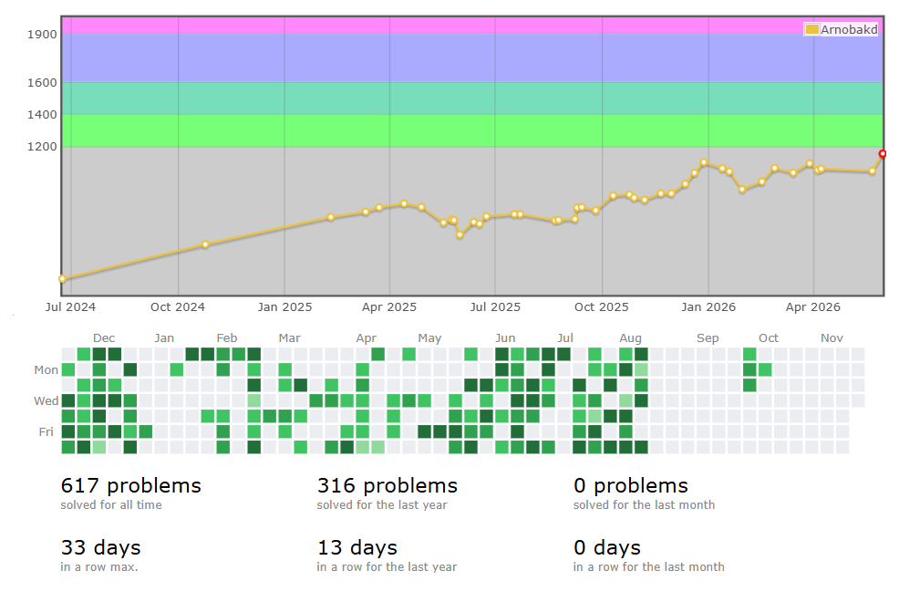
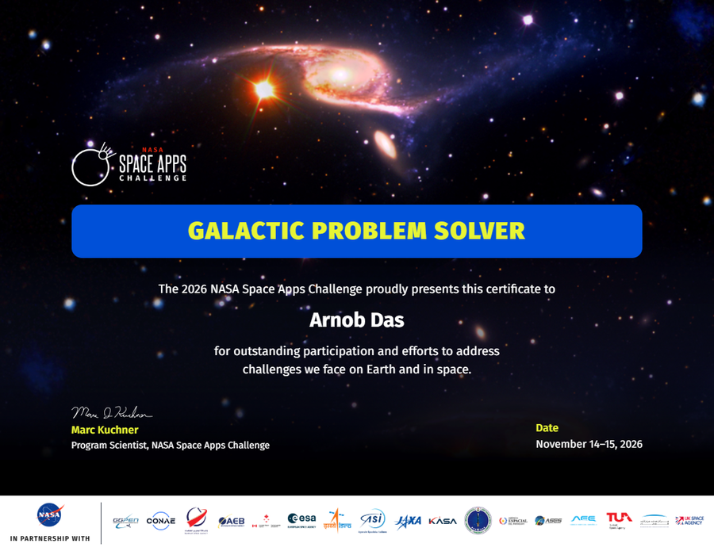

  
  
  
  
  

## 👋 About Me

- 🎓 I'm **Arnob Das**, a 3rd-year Computer Science & Engineering student at **American International University-Bangladesh (AIUB)**.
- 🏆 I'm a competitive programmer with **1000+ problems solved** across all online judges, and my Codeforces rating is **1157**.
- 💻 I write code in **Java, C#, C++ and C**, and I have a strong understanding of **Object-Oriented Programming (OOP)** concepts, which I apply in my projects.
- 🗄️ I'm comfortable with databases, especially **MySQL**, which I've used in my **Java and C#** projects.
- 🌱 I'm currently learning **backend development** and building backend projects.
- 🔧 Recently, I've been building **my own C compiler** using the C language.
- 🤖 I'm also working on an **AI agent that checks prize bond results**.
- 🔬 I'm a **research enthusiast** and love exploring new ideas.
- 🚀 I took part in the **NASA Space Apps Challenge 2026** hackathon and built a project with my team.

## 🌐 Connect With Me

  
  
  

## 🛠️ Tech Stack

  

## 📊 GitHub Stats

  
  

  

## ⚔️ Competitive Programming

<b>📈 Click to see my coding activity</b>

 

  

## 🏆 Achievements

- 🥇 Solved **1000+ problems** across all online judges
- 📈 Codeforces rating: **1157**
- ⚔️ Competitive programming experience of **2+ years**, with C++ as my strongest language
- 🧠 Active on **Codeforces** and **VJudge**
- 🚀 Participated in the **NASA Space Apps Challenge 2026** hackathon and received the **"Galactic Problem Solver"** certificate for building [**AegnyxZero**](https://github.com/HippomasAKiB1/aegnyxzero)

 

  
  
  
  
  

<b>🌌 Click to see my NASA Space Apps Challenge 2026 certificate</b>

 

  

## 🚀 Featured Projects

  
  
  
  
  
  
  
  
  

## 🚧 Currently Building

  
  

  🛠️ <b>C Compiler</b> — my own compiler written in C, starting with the basics and upgrading step by step. 
  🤖 <b>Prize Bond AI Agent</b> — an AI agent that checks prize bond results automatically.

## 🐍 Contribution Snake

  <picture>
    <source media="(prefers-color-scheme: dark)" srcset="https://raw.githubusercontent.com/arnob-akd/arnob-akd/output/github-snake-dark.svg" />
    <source media="(prefers-color-scheme: light)" srcset="https://raw.githubusercontent.com/arnob-akd/arnob-akd/output/github-snake.svg" />
    
  </picture>

## 💭 Quote of the Moment

  

  

